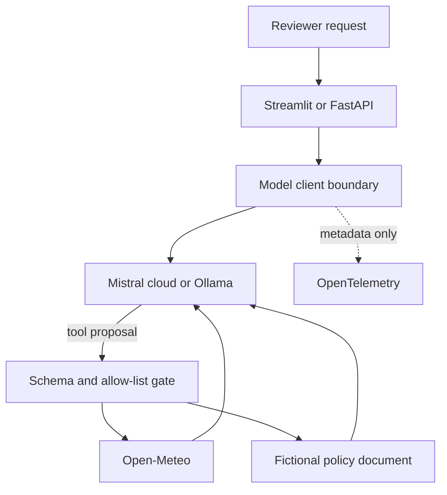

# Agent Reliability Lab: technical guide

[Back to the quick start](README.md). Detailed reference and historical evidence.

## What reviewers can verify

| Concern | Implementation | Evidence |
|---|---|---|
| Tool control | JSON schemas, application allow-list, bounded tool rounds | `demo_streamlit.py`, `llm_client.py` |
| Grounding | Fictional local policy document with named source sections | `showcase.py`, `RAG/hr_policy.md` |
| Resilience | Retry `429` and transient `5xx`, honor `Retry-After`, add jitter | `llm_client.py`, unit tests |
| Privacy | Prompt, response, arguments, and results excluded from logs/spans | `llm_client.py`, privacy regression tests |
| Observability | Opt-in OpenTelemetry with latency, usage, tool, and error metadata | `llm_client.py` |
| Regression safety | Secret-free CI, deterministic evals, locked dependency audit | `.github/workflows/ci.yml`, `evals/`, `uv.lock` |
| Provider choice | Mistral cloud or local Ollama through one client boundary | `config.py`, `llm_client.py` |

## Connected mode

### Mistral cloud

```bash
cp .env.example .env
# Add MISTRAL_API_KEY to .env
uv run streamlit run demo_streamlit.py
```

### Local model with Ollama

```bash
ollama pull mistral
LLM_BACKEND=local MISTRAL_MODEL=mistral uv run streamlit run demo_streamlit.py
```

Connected mode sends every request to the model with both tools available. The model
proposes tool calls; application code validates the tool name against the allow-list,
executes it, appends the result, and asks the model for a grounded final answer.

## Architecture



Trust boundaries are intentional:

1. The model can propose a tool call but cannot register or execute arbitrary code.
2. Tool schemas are declared to the model. The application checks that arguments parse as an object and the tool name is allow-listed; it does not independently validate the complete argument schema.
3. Connected tools return data to the model; only the model's final text reaches the UI.
4. Logs and spans record operational metadata, not user or tool content.

See [SECURITY.md](SECURITY.md) for production gaps and security assumptions.

## Evaluation contract

Run the offline regression suite:

```bash
uv run ruff check .
uv run pytest -q
uv run python -m evals.run_evals
uv export --locked --no-dev --no-hashes --output-file /tmp/audit-requirements.txt
uv run pip-audit --requirement /tmp/audit-requirements.txt --strict
```

The versioned cases check deterministic boundaries around the model:

- request route and expected tool;
- grounded policy facts and named sources;
- refusal to fabricate live weather in preview mode;
- explicit behavior for unsupported preview requests.

These checks do not measure model quality. A production extension should add versioned
provider runs, calibrated human labels, a failure taxonomy, and latency/cost thresholds.

## Other runnable surfaces

```bash
uv run uvicorn api:app --host 127.0.0.1 --port 8000  # FastAPI + /docs
uv run python demo_chat.py                           # Multi-turn CLI
uv run python demo_tools.py --interactive             # Tool-call loop
uv run python demo_structured.py                      # Typed JSON output
```

The FastAPI endpoints are intentionally local-only. `/chat` and `/summarize` require
an `X-API-Key` matching `API_KEY` in `.env`; `/health` is unauthenticated.

## Configuration

| Variable | Default | Purpose |
|---|---|---|
| `LLM_BACKEND` | `api` | `api` for Mistral or `local` for Ollama |
| `MISTRAL_API_KEY` | — | Required only for connected Mistral mode |
| `MISTRAL_MODEL` | `mistral-large-latest` (API), `mistral` (local) | Cloud or local model name |
| `MISTRAL_MAX_TOKENS` | `1024` | Maximum generated tokens |
| `MISTRAL_TEMPERATURE` | `0.0` | Sampling temperature |
| `MISTRAL_TOP_P` | unset | Optional nucleus sampling; avoid combining with temperature |
| `REQUEST_TIMEOUT` | `30` | Local-provider request timeout in seconds |
| `RETRY_MAX_ATTEMPTS` | `3` | Total attempts, including the first |
| `RETRY_BASE_DELAY` | `0.5` | Initial retry delay in seconds |
| `RETRY_MAX_DELAY` | `60.0` | Maximum retry delay in seconds |
| `MAX_TOOL_ROUNDS` | `4` | Maximum model/tool cycles per request |
| `OTEL_ENABLED` | `false` | Opt in to trace export |
| `OTEL_EXPORTER_OTLP_ENDPOINT` | `http://localhost:4317` | OTLP/gRPC endpoint |
| `API_KEY` | — | Protects local FastAPI model endpoints |
| `OLLAMA_BASE_URL` | `http://localhost:11434/v1` | Local OpenAI-compatible endpoint |
| `LOG_LEVEL` | `INFO` | Operational log level |

`config.py` is the authority for defaults and validation.

Use a pinned model ID for repeatable evaluation runs; `latest` aliases are convenient
for exploration but can change behavior over time.

## Project map

| Path | Purpose |
|---|---|
| [demo_streamlit.py](demo_streamlit.py) | Reviewer UI and tool gate |
| [llm_client.py](llm_client.py) | Provider boundary, retries, tool loop, tracing |
| [showcase.py](showcase.py) | Credential-free preview and retrieval |
| [api.py](api.py) | Typed localhost HTTP surface |
| [evals/](evals/) | Deterministic evaluation contract |
| [tests/](tests/) | Unit, privacy, and UI interaction tests |
| [RAG/hr_policy.md](RAG/hr_policy.md) | Synthetic grounding document |
| [prompts/](prompts/) | Version-controlled prompt templates |

## Deliberate limits

- The policy corpus is tiny and synthetic; retrieval is transparent token overlap,
  not a vector database.
- Weather is the only live external tool.
- Authentication is suitable for a local demo, not a public multi-tenant endpoint.
- No claims are made about safety, correctness, or availability beyond the tested paths.
